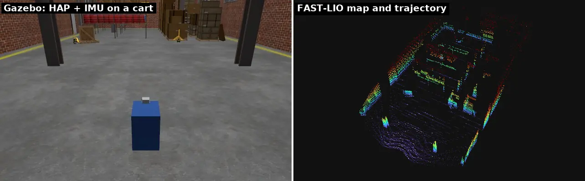
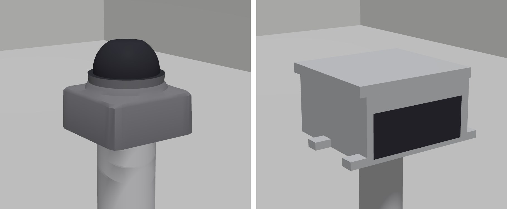
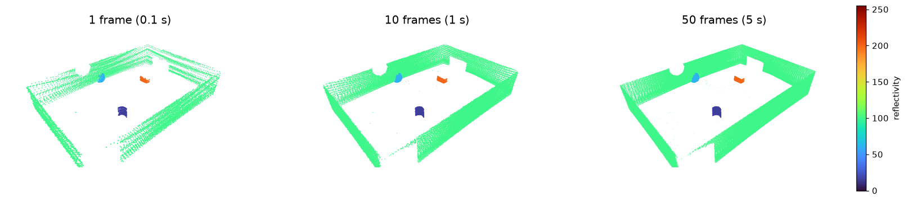
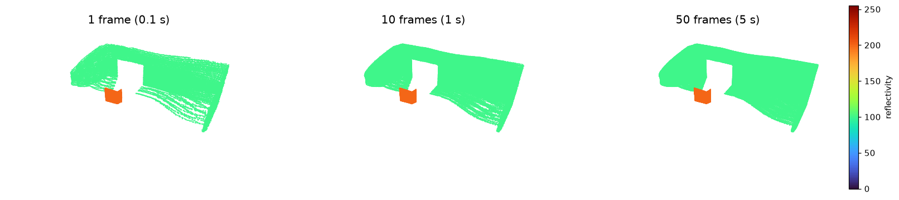

# livox_gz_sim

Livox lidars for **Gazebo Sim (Harmonic) and ROS 2 Jazzy**: the real non-repetitive scan
pattern, realistic timing and noise, and output that matches what
[`livox_ros_driver2`](https://github.com/Livox-SDK/livox_ros_driver2) publishes. The same
LIO / SLAM stack (e.g. FAST-LIO) can run in simulation and on the robot.



*A HAP and an IMU on a cart driven through the [Depot](https://app.gazebosim.org/OpenRobotics/fuel/models/Depot)
world, mapped by unmodified [FAST-LIO](https://github.com/hku-mars/FAST_LIO) (3× speed). Over
the 47 m drive the odometry stays within 0.2 m of ground truth.*

| Model | FOV | Points/s | Range | IMU |
|---|---|---|---|---|
| **Mid-360** | 360° × −7…52° | 200k | 0.1–40 m | ✓ (ICM-40609) |
| **HAP (TX)** | 120° × 25° | 452k | 0.5–150 m | — |



## Features

- **Livox's recorded scan patterns**: every frame takes the next rays of the pattern, so
  coverage builds up over frames as on the real sensor.
- **Driver-identical output**: `sensor_msgs/PointCloud2` in the driver's 26-byte
  `x y z intensity tag line timestamp` layout, or `livox_ros_driver2/CustomMsg`
  (`xfer_format` 0 / 1). `line` is numbered as the driver numbers it; stamps are in sim
  time; points with no return are dropped.
- **Per-point time**: a frame is rendered as several time slices (5 by default), and each
  point is stamped with the time it was measured. Motion during a frame skews the cloud
  as on the real sensor, and deskewing it (as FAST-LIO does) is exact.
- **Datasheet noise**: range noise and angular error (1σ), with the angular error
  including the rendering's pixel quantisation.
- **Reflectivity** from each surface's `<laser_retro>`, on Livox's 0–255 scale.
- **Mid-360 IMU**: `sensor_msgs/Imu` at 200 Hz in g, as the driver publishes it, at the
  position given in the user manual, with ICM-40609 datasheet noise.
- **Real dimensions**: frames, masses and low-poly meshes measured from Livox's user
  manual (Mid-360) and STEP model (HAP).
- `publish_freq`, `downsample` and multiple sensors (one `name` / `topic` each); handles
  world resets.

## Requirements

- ROS 2 Jazzy and Gazebo Harmonic (gz-sim 8), via the `ros_gz` / `gz_*_vendor` packages
- `livox_ros_driver2` (for its message types; the driver itself does not run)
- A GPU with OpenGL: the lidar is rendered by Gazebo's `gpu_lidar`

## Build

Clone into the `src/` of a colcon workspace and build as usual:

```bash
mkdir -p ~/lidar_ws/src && cd ~/lidar_ws/src
git clone https://github.com/mathaimp/livox_gz_sim.git
cd ~/lidar_ws && colcon build --symlink-install --packages-select livox_gz_sim
source install/setup.bash
```

The repo also carries a [pixi](https://pixi.sh) environment (`pixi.toml`, robostack-jazzy)
with everything needed; from `src/livox_gz_sim`, `pixi run build` builds the package into
the workspace.

Sourcing the workspace puts the plugins on `GZ_SIM_SYSTEM_PLUGIN_PATH` (environment hook).

## Demo

A sensor on a 1 m pole in a small room with a few objects of different reflectivity:

```bash
ros2 launch livox_gz_sim demo.launch.py                 # Mid-360, Gazebo GUI + rviz
ros2 launch livox_gz_sim demo.launch.py model:=hap
ros2 launch livox_gz_sim demo.launch.py gui:=false rviz:=false xfer_format:=1
```

| Argument | Default | |
|---|---|---|
| `model` | `mid360` | `mid360` or `hap` |
| `gui`, `rviz` | `true` | |
| `xfer_format` | `0` | 0 PointCloud2, 1 CustomMsg (rviz cannot show CustomMsg) |
| `publish_freq` | `10.0` | frames per second |
| `slices` | `5` | rendered images per frame |
| `resolution` | model's | dense image grid, deg |
| `downsample` | `1` | keep every n-th ray |

Clouds from the demo, coloured by reflectivity. The Mid-360's
non-repetitive pattern fills in over frames:



The HAP, with 2.3× the point rate in a 120° × 25° FOV, is dense from the first frame:



## Using it on a robot

```xml
<xacro:include filename="$(find livox_gz_sim)/urdf/mid360.xacro"/>
<xacro:mid360 parent="base_link">
  <origin xyz="0.1 0 0.25" rpy="0 0 0"/>
</xacro:mid360>

<xacro:include filename="$(find livox_gz_sim)/urdf/hap.xacro"/>
<xacro:hap parent="base_link" name="front" topic="front/lidar">
  <origin xyz="0.3 0 0.1"/>
</xacro:hap>
```

The `origin` places the **centre of the sensor's bottom face**. Each macro creates:

- `${name}_base_link`: housing (mesh, box collision, mass)
- `${name}_frame`: the point cloud origin; the cloud is published in this frame
- `${name}_imu_link` (Mid-360): the IMU, whose data is published in `${name}_frame` axes

| Macro argument | Default | |
|---|---|---|
| `name` | `livox` | prefix of the links, sensors and gz topics |
| `topic` | `livox/lidar` | ROS topic of the cloud |
| `imu_topic` (Mid-360) | `livox/imu` | ROS topic of the IMU |
| `xfer_format` | `0` | 0 PointCloud2, 1 CustomMsg |
| `publish_freq` | `10.0` | Hz; a frame is 1 / publish_freq of the point stream |
| `slices` | `5` | images per frame; points are stamped with their image's time |
| `resolution` | `0.4` (Mid-360), `0.2` (HAP) | dense image grid, deg (empty: the default) |
| `downsample` | `1` | keep every n-th ray, to save CPU |

The world needs the sensor systems, and Gazebo must find the meshes:

```xml
<plugin filename="gz-sim-sensors-system" name="gz::sim::systems::Sensors">
  <render_engine>ogre2</render_engine>
</plugin>
<plugin filename="gz-sim-imu-system" name="gz::sim::systems::Imu"/>  <!-- Mid-360 IMU -->
```

```bash
# package://livox_gz_sim/meshes/... resolves through this (demo.launch.py does it)
export GZ_SIM_RESOURCE_PATH=$GZ_SIM_RESOURCE_PATH:$HOME/lidar_ws/install/livox_gz_sim/share
```

Give surfaces a reflectivity with `<laser_retro>` in their visual (0–150 diffuse %,
151–255 retroreflective); surfaces without one read 100.

## Output

| Topic | Type | |
|---|---|---|
| `livox/lidar` | `PointCloud2` or `CustomMsg` | in `${name}_frame`, QoS reliable, keep last 5 |
| `livox/imu` | `sensor_msgs/Imu` | Mid-360, 200 Hz, angular velocity rad/s, **acceleration in g**, no orientation |

PointCloud2 fields (packed, 26 bytes per point, as the driver's `LivoxPointXyzrtlt`):

| Field | Offset | Type | |
|---|---|---|---|
| `x` `y` `z` | 0, 4, 8 | float32 | m |
| `intensity` | 12 | float32 | reflectivity 0–255 |
| `tag` | 16 | uint8 | 0 |
| `line` | 17 | uint8 | point index % lines (4 Mid-360, 6 HAP) |
| `timestamp` | 18 | float64 | absolute time, ns |

The header stamp (CustomMsg: `timebase`) is the start of the frame; a point's offset
(`offset_time`) is the time of its slice. The frame is published once it is complete.

## How it works

A `gpu_lidar` renders a dense range image (e.g. 0.4° grid over the sensor's FOV) and the
`livox_gz_sim::LivoxLidar` plugin reads it along Livox's recorded ray directions,
`point rate / publish_freq` rays per frame. With `slices: n` the image is rendered n times
per frame and each rendering supplies the next 1/n of the frame's rays, stamped with its
time: with 5 slices at 10 Hz, the offsets are 0, 20, …, 80 ms.

Noise is added by the plugin to the rays it uses (the `gpu_lidar` has no `<noise>`; per
pixel it would dominate the cost). Reading the nearest pixel is itself an angular error
of step/√12 per axis, so the plugin adds only the rest of the datasheet's angular error,
and a coarser image costs no accuracy while step/√12 stays below it (0.5° for the
Mid-360, 0.34° for the HAP).

## Performance

The cost is rendering, about proportional to `slices × publish_freq × FOV / resolution²`.
With the defaults the demo runs at 2.7× (Mid-360) and 3.5× (HAP) real time on an RTX 3050
laptop. Lower `slices` or a coarser `resolution` trade realism for speed; `downsample`
reduces the number of points.

## FAST-LIO

Tested with [FAST-LIO](https://github.com/hku-mars/FAST_LIO) (ROS2 branch) on a moving
rig. Use `xfer_format:=1` (CustomMsg) and the stock `config/mid360.yaml`; its
`extrinsic_T [-0.011, -0.02329, 0.04412]` is the simulated IMU position.

## Limitations

- **Moving objects** are sampled once per slice (20 ms steps by default); within a slice
  they are frozen.
- Single return; `tag` is always 0; `xfer_format: 2` (PCL, ROS 1 only in the driver) is
  not provided; points are in the sensor frame (no driver-side extrinsic).

## License and credits

MIT (see `LICENSE`).

- Scan patterns (`scan_patterns/*.csv`): Livox,
  [livox_laser_simulation](https://github.com/Livox-SDK/livox_laser_simulation), MIT
  (`scan_patterns/LICENSE.livox`). The idea of sampling a recorded pattern is theirs.
- Prior Livox simulators for Gazebo Classic this one builds on:
  [Livox-SDK/livox_laser_simulation](https://github.com/Livox-SDK/livox_laser_simulation), 
  [LCAS/livox_laser_simulation_ros2](https://github.com/LCAS/livox_laser_simulation_ros2)
  and [mit-acl/livox_laser_simulation_ros2](https://github.com/mit-acl/livox_laser_simulation_ros2),
  and [fratopa/Mid360_simulation_plugin](https://github.com/fratopa/Mid360_simulation_plugin).
- Dimensions: Livox Mid-360 user manual; Livox HAP (TX) STEP model, specs and user
  manual. The meshes are low-poly models made from these measurements.
- IMU noise: TDK ICM-40609-D datasheet (DS-000330 v1.2).
